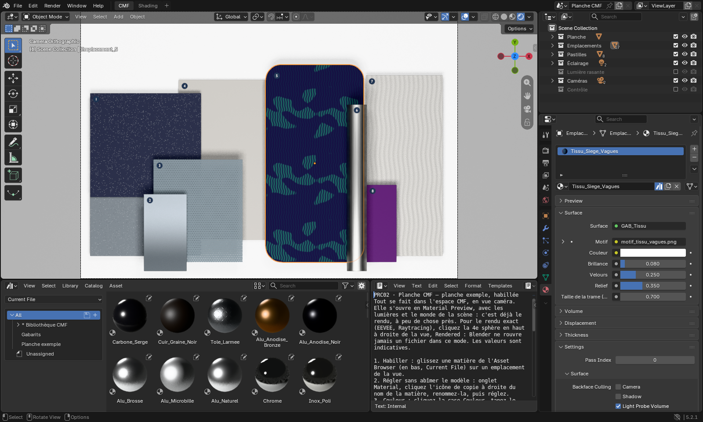

# Planche CMF en 3D : les cinq gestes

PRC02 · Design & visualisation temps réel avec Blender · Blender 5.2 LTS, interface en anglais
Fichier `PRC02_CMF_planche.zip` · Version du 24 novembre 2026

## Avant de commencer

- **Décompressez le zip et gardez le dossier entier :** le fichier `blender_assets.cats.txt` range les matières dans l'Asset Browser.
- **Ouvrez `PRC02_CMF_planche_vierge.blend`,** puis *File > Save As* sous votre nom. La planche exemple sert de modèle.
- **Tout se passe dans l'espace CMF :** la vue caméra au centre, l'Asset Browser et le LISEZ-MOI en bas, l'onglet *Material* à droite. La vue s'ouvre en *Material Preview*, avec les lumières de la scène ; pour le rendu exact, cliquez la 4e sphère en haut à droite de la vue, *Rendered*.

## Les cinq gestes

1. **Habiller un emplacement :** glissez une matière de l'Asset Browser sur une plaque de la vue caméra. Ses catalogues : *Bibliothèque CMF*, *Gabarits*, *Planche exemple*. Ensuite, dans l'onglet *Material*, cliquez l'icône de copie à droite du nom (*New Material*) et renommez la copie : vous réglez votre version sans toucher au modèle.
2. **Changer une couleur en hexadécimal :** dans l'onglet *Material*, cliquez la case *Couleur*, puis tapez le code de votre nuancier dans le champ *Hex* (ex. `1F2A44`) et validez par `Entrée`. *Brillance* et *Relief* vont de 0 à 1 ; les tailles sont en millimètres.
3. **Charger l'image d'un motif :** sur une copie de *Gabarit_Tissu_Motif*, rubrique *Surface*, dépliez *Motif*. Cliquez *Open* (l'icône de dossier) et choisissez votre image, un PNG ou un JPEG à raccord. Réglez ensuite *Taille du motif (mm)* et *Rotation*. Avant d'envoyer le fichier : *File > External Data > Pack Resources*.
4. **Passer à la vue rasante :** dans l'Outliner, cochez la collection *Lumière rasante*. Cliquez *CAM_Rasante*, puis *View > Cameras > Set Active Object as Camera*. Relief, grain et brillance s'y lisent. Pour revenir : même geste sur *CAM_Planche*, et décochez la collection.
5. **Exporter :** enregistrez le fichier, puis `Ctrl + F12`. L'image A4 paysage, de 2339 x 1654 px (200 dpi), s'écrit dans `rendus/planche_0001.png`, à côté du fichier. Pour l'image finale, choisissez *Render Properties > Render Engine > Cycles*, puis `Ctrl + F12` : le rendu prend quelques minutes. Revenez ensuite à *EEVEE* pour travailler.

## Bon à savoir

- **L'éclairage et le *Color Management* sont réglés pour que la couleur de base se lise juste :** *Khronos PBR Neutral*, *Look None*, *Exposure 0*. N'y touchez pas. Pour le vérifier, cochez la collection *Contrôle* : le gris 18 % se lit vers 118 dans l'image.
- **Les gabarits :** laque ou peinture, plastique grainé (mouchetures en option), métal brossé, tissu à motif, perforé, translucide côtelé, anodisé en dégradé. Ils n'ont pas besoin de dépliage UV.
- **Une plaque se déplace avec `G` :** sa pastille la suit. `Ctrl + Z` annule le dernier geste.
